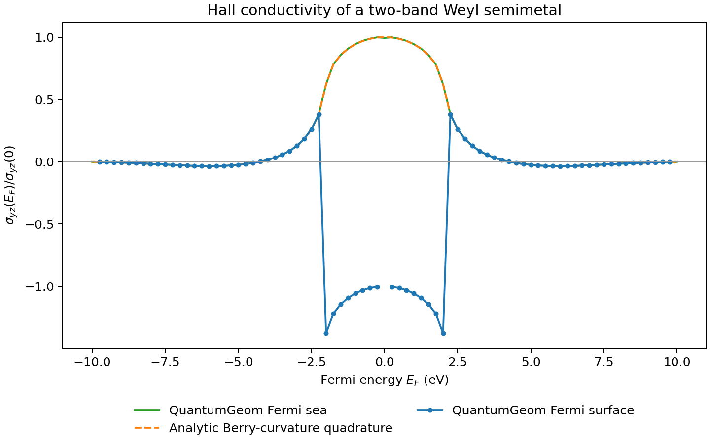

# QuantumGeom

QuantumGeom is a Python package for the geometry and topology of tight-binding
models. It extracts periodic Fermi surfaces from Wannier90 models, computes
Berry phases, and evaluates intrinsic anomalous Hall conductivity using both
Fermi-surface and Fermi-sea integration. The `Chain` interface computes Zak phases
for one-dimensional models.

## Build from source

On Linux or Windows with WSL 2, use Git and a Conda distribution such as
Miniforge. For macOS and other toolchains, see the [installation guide](docs/Installation.rst).

```bash
git clone https://github.com/gy114/QuantumGeom.git
cd QuantumGeom
conda env create -f environment-cmake.yml
conda activate quantumgeom-cmake

cmake -S . -B build -DCMAKE_BUILD_TYPE=Release \
    -DCMAKE_PREFIX_PATH="$CONDA_PREFIX" \
    -DPython3_EXECUTABLE="$CONDA_PREFIX/bin/python"
cmake --build build --target quantumGeom --config Release --parallel 2
cmake --install build --config Release
python -c "import quantumGeom; print(quantumGeom.__version__)"
```

## Weyl Hall conductivity example

From the repository root, run the bundled two-band Weyl model.

```bash
python examples/weyl_hall_conductivity.py --step 2.5
```

The script writes `weyl_hall_conductivity.png` and `weyl_hall_conductivity.csv`.
The plot compares both native Hall integrals with an independent calculation
using the model's analytic Berry curvature.



## Documentation

The [QuantumGeom documentation](https://gy114.github.io/QuantumGeom/) covers
installation, Hall conductivity workflows, and the Python API.

## License

QuantumGeom is licensed under the
[GNU Lesser General Public License, version 3 or later](LICENSE). Yin's group
in the Department of Physics at Georgetown University maintains the project.
