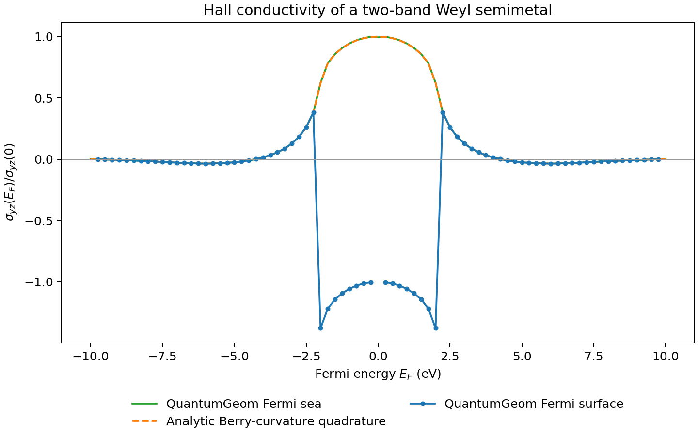

.. _anomalous-hall-conductivity:

Anomalous Hall conductivity
===========================

Both methods return a Cartesian antisymmetric :math:`3\times3` geometric tensor
:math:`M` in Å⁻¹. The intrinsic Hall conductivity is

.. math::

   \sigma_{ij} = -\frac{e^2}{\hbar(2\pi)^3}\,M_{ij}.

Use consistent units for the tensor and the prefactor.

.. _fermi-surface-method:

Fermi-surface method
--------------------

After :ref:`generating a surface and computing its Berry phases
<fermi-surfaces-and-berry-phases>`, evaluate the Haldane integral for that
surface.

.. code-block:: python

   hall_tensor = surface.intrinsicMatrixOfHaldaneIntegral()

:py:meth:`~quantumGeom.FermiSurface.intrinsicMatrixOfHaldaneIntegral` weights
the triangle fluxes with the stored vertex coordinates and accounts for the
reciprocal-lattice jumps along paired periodic edges. The triangles and their
Berry fluxes stay intact. The boundary correction uses the same rank-one Berry
links as a resolved sheet or the determinant links used for a shared multiplet.
Sum the tensors over all bands with a Fermi surface, counting a coincident
degenerate multiplet once.

The Fermi-surface integral determines the Hall conductivity modulo quantized
contributions associated with reciprocal-lattice vectors. The occupied-state
integral also includes the quantized Hall contribution of fully occupied bands.
See `Haldane's Fermi-surface formulation <https://arxiv.org/abs/cond-mat/0408417>`_.

.. _fermi-sea-method:

Fermi-sea method
----------------

:py:meth:`~quantumGeom.Bulk.intrinsicMatrixOfFermiSeaIntegral` integrates the
occupied Berry curvature at zero temperature on the current periodic Delaunay
mesh. For each tetrahedron, the integral multiplies the Berry curvature at
the centroid by the occupied volume from linear interpolation of the band
energies. It uses the Hamiltonian and its derivatives in the model's fixed
orthonormal tight-binding basis. Initialize the mesh for the current Hamiltonian
before calling the integral.

Run this example from the repository root.

.. code-block:: python

   import numpy as np
   import quantumGeom as qg

   bulk = qg.Bulk("examples/weyl_semi_tb.dat")
   bulk.initializeTheMeshParallel(20000, 4)
   energies = [-0.5, 0.0, 0.5]
   hall_tensors = np.asarray(bulk.intrinsicMatrixOfFermiSeaIntegral(energies, num_threads=4))
   yz_integrals = hall_tensors[:, 1, 2]

The method takes a sequence of Fermi energies in eV and returns one tensor
per energy in the same order. Increase the global mesh density to check
convergence, particularly near band crossings where the Berry curvature
changes rapidly.

.. _weyl-hall-comparison:

Weyl 2×2 comparison
-------------------

         follows the analytic reference. The Fermi-surface result drops by one
         Hall quantum near the Weyl nodes.

   The two native methods and an independent quadrature of the analytic Berry
   curvature, sampled every 0.25 eV. All curves are normalized to the exact
   Weyl-node value :math:`e^2/(2ha)`, where :math:`a` is the cubic lattice spacing.

The curves are shown on their original Hall branches. The Fermi-surface result
may differ from the Fermi-sea result by integer multiples of :math:`e^2/(ha)`.

From the repository root, run the bundled example to scan the Fermi energy.

.. code-block:: console

   $ python examples/weyl_hall_conductivity.py

The script writes ``weyl_hall_conductivity.png`` and a CSV in the current
directory. The CSV also records the surface-minus-sea difference modulo the
Hall quantum so you can check numerical convergence.
